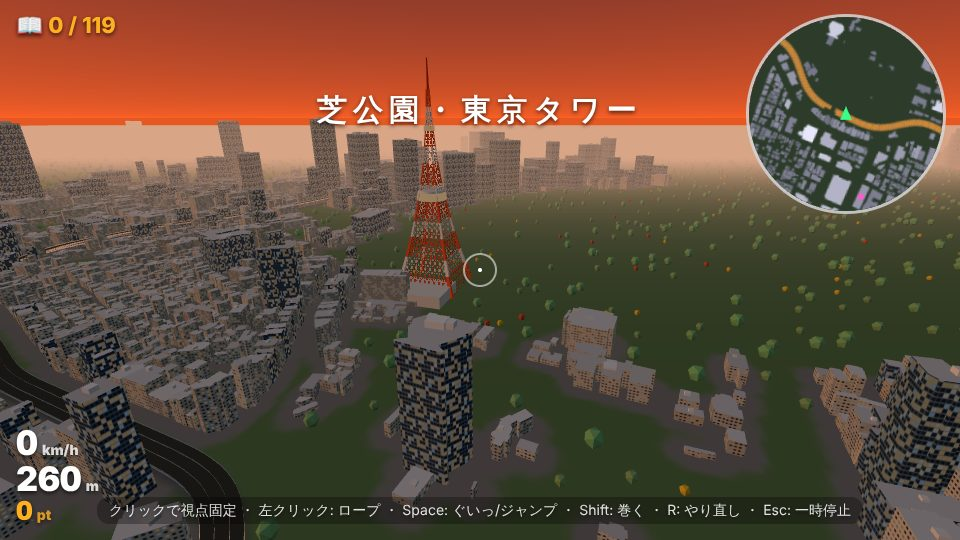
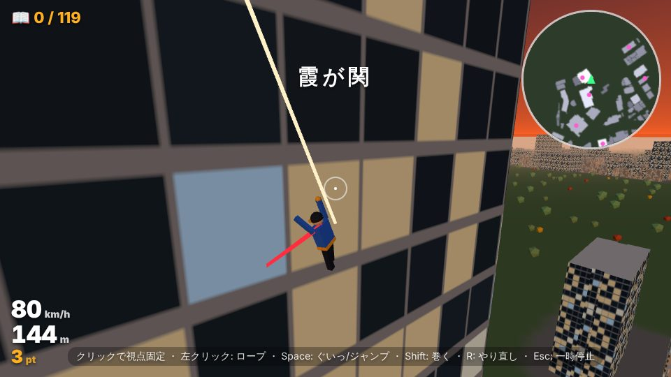
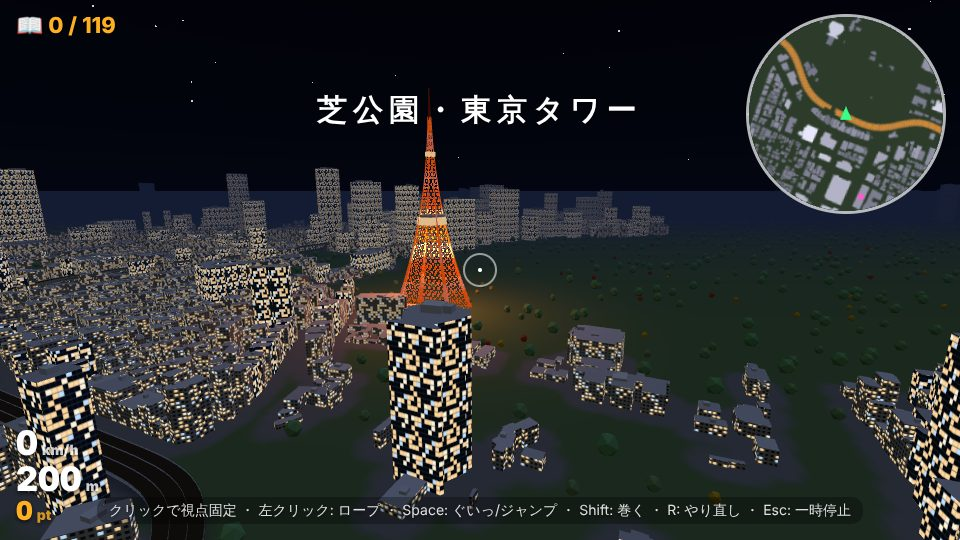

# 東京ターザン（TOKYO TARZAN）

実在の東京都心を 3D で再現した街を、ロープ1本でビルからビルへ飛び移っていくブラウザ 3D アクションです（three.js）。
ビルの形と高さは **国土交通省 PLATEAU** の 3D 都市モデル、首都高の高架は **OpenStreetMap** の線を使っていて、
新宿・渋谷・六本木・霞が関・銀座・汐留・東京駅・大手町など、首都高に沿った都心の約2.9万棟が実際の輪郭と高さで建っています。



 

## 遊び方

```sh
python3 -m http.server 8000
# → http://localhost:8000/
```

ES Modules を使うので `file://` では動きません。ビルド不要の静的ファイルです。

| 操作 | パソコン | スマホ |
| --- | --- | --- |
| 視点 | マウス（画面をクリックで固定） | 画面の右側をドラッグ |
| ロープ | 左クリック（押している間ぶら下がる。離すと手を離す） | ロープ ボタン |
| ぐいっ（引き寄せ） | Space（ぶら下がり中）／ E | ぐいっ |
| ジャンプ | Space（立っているとき） | ジャンプ |
| 巻き取る／のばす | Shift・右クリック ／ Q | 巻く |
| 移動・こぐ | W A S D | 左のスティック |
| やり直し | R | — |
| 一時停止／消音 | Esc・P ／ M | ❚❚ |

## ゲームのしくみ

### ロープアクション
- 照準が **緑** になったら、そこにロープが届く（最大150m）。照準の真ん中に壁がなくても、近くの壁を自動で探す（スマホは広め）
- ロープは張っているときだけ効く「伸びない振り子」。重力は本物の約3倍にしてあり、ビルの大きさで振り子が気持ちよく回る
- ぶら下がりながら **W で前にこぐ** と振り子が大きくなる。**Shift で巻き取る** と上に登れる
- **ぐいっ**（Space）でアンカーに向かって一気に引き寄せる（0.9秒ごと）
- 振り子の **いちばん下を過ぎて上がり始めたところで手を離す** と「ナイスリリース！」で 14% 加速して少し浮く。タイミングが腕の見せどころ
- 振り子の最下点が地面にぶつかりそうなら自動で少し巻き取る（地面すれすれを抜けるアシスト）
- 壁に当たると減速、強く当たると「ゴツン！」。高い所から落ちて強く着地すると少しよろける
- 屋上と首都高の高架の上は走れる・着地できる

### 得点
- **コンボ**: 地面に足を着けずにロープをつなぐたびに +1。得点の倍率が上がる（最大 ×8.5）。
  屋上や高架の上なら1秒までは着地してもコンボが続く。地面に降りると終わる
- 空中にいる間は速さに応じて加点、ナイスリリース +200、壁すれすれを高速で抜ける **ニアミス** +300（いずれもコンボ倍率つき）

### 配達ミッション（タイムアタック）
空中に浮かぶ金色の輪を順にくぐってゴールを目指す。次の輪は光の柱と画面上の矢印（▲▼ は上下）で分かる。
タイムに応じて ★1〜3、ベストタイムはブラウザに保存。

| ミッション | ルート |
| --- | --- |
| 霞が関デビュー | 霞が関ビルの屋上 → 虎ノ門 → 虎の門病院 → 赤坂インターシティAIR → 山王パークタワー → 国会議事堂（チュートリアル） |
| 六本木 → 東京タワー | 森タワーの屋上 → 東京ミッドタウン → 六本木一丁目 → 神谷町 → **東京タワーの脚の間** → **展望台の横** → 芝公園 → 世界貿易センタービル |
| 汐留 → 銀座 → 東京駅 | 汐留シティセンターの屋上 → 電通本社ビル → 銀座 → 京橋 → 八重洲 → 日本橋三井タワー → 大手町タワー |
| 新宿 → 渋谷 | 新宿パークタワーの屋上 → 初台 → 山手通りを南へ → 大橋 → 道玄坂上 → マークシティ → 渋谷スクランブルスクエア |
| C1 ぐるり大冒険 | 霞が関 → 新橋 → 汐留 → 銀座 → 京橋 → 日本橋 → 大手町 → 神保町 → 九段 → 千鳥ヶ淵 → 紀尾井町 → 赤坂 → 霞が関（約10km） |

### フリーターザン・ビル図鑑
霞が関ビルの屋上から自由に飛び回るモード。**PLATEAU に名前が入っている建物**（霞が関ビルディング・汐留メディアタワー・日本テレビタワー・渋谷ヒカリエ・大手町タワーなど119棟と、東京タワー・国会議事堂）に
ロープを掛けると「ビル図鑑」に登録される（+1000pt）。ミニマップのピンクの点がまだ登録していない建物。
ロープを掛けた建物の名前と高さが画面に出るので、実在の街を探検する楽しみがある。

### 街の演出
- 今いる地域（霞が関・銀座・六本木・渋谷…）に入ると画面に地名が出る
- 時間帯は「昼」「夕暮れ」「夜」（夜は窓明かりとオレンジに光る東京タワー、星空）
- PLATEAU では箱になってしまう **東京タワー**（トラスと脚の間をくぐれる当たり判定）と **国会議事堂** は手作りのモデル。遠くに東京スカイツリーと富士山
- 首都高の高架（橋脚つき）、屋上の設備、データの範囲外（皇居・神宮外苑・赤坂御用地・住宅地）は緑地と木々（10月なので銀杏の黄色と紅葉）
- 速さに応じて視野が広がり、集中線と風切り音

## 街のデータの作り方

`js/city-data.js` は [首都高グランプリ](https://github.com/techgymjp/shutoko) のコースデータ（`js/course-*-data.js`。首都高に沿った PLATEAU の建物と OSM の首都高の線）から作ります。

```sh
git clone --depth 1 https://github.com/techgymjp/shutoko ../shutoko
python3 tools/build_city.py ../shutoko/js > js/city-data.js
```

- 全コースの建物を緯度経度に戻し、都心の範囲（北緯35.645〜35.700、東経139.690〜139.785）にあるものを、原点を国会議事堂のあたりにした1つの座標系（x: 東、z: 南、m）にまとめる
- 複数のコースに入っている同じ建物は、重心と高さで見分けて1つにする
- 首都高の線も重なりを除いて1本にする（トンネル区間は印を付けて描かない）

## ファイル構成

| ファイル | 内容 |
| --- | --- |
| `index.html` / `css/style.css` | 画面（タイトル・HUD・スマホの操作ボタン） |
| `js/main.js` | 進行・入力・カメラ・照準（自動照準）・ミッション・得点・図鑑・ミニマップ・空と時間帯 |
| `js/player.js` | プレイヤーの物理（振り子のロープ・走る・跳ぶ・壁と床の当たり判定）とキャラクター・マフラー・ロープの見た目 |
| `js/city.js` | ビルの描画（タイルごとにまとめたメッシュ・窓のテクスチャ・屋上の設備）、首都高の高架、当たり判定、ロープを掛ける所を探すレイキャスト |
| `js/landmarks.js` | 東京タワー・国会議事堂・スカイツリー・富士山 |
| `js/missions.js` | 配達ミッションのルートと地域名 |
| `js/audio.js` | 効果音（すべて WebAudio で合成） |
| `js/city-data.js` | 街のデータ（自動生成） |
| `tools/build_city.py` | 街のデータを作るスクリプト |

テスト用に `index.html?debug` で開くと、コンソールから `dbg`（`dbg.player`・`dbg.city`・`dbg.startGame(dbg.MISSIONS[0])` など）が使えます。

## 公開

`.github/workflows/pages.yml` で、`main`（または今のデフォルトブランチ `claude/relaxed-hamilton-sujag7`）に push すると GitHub Pages に公開します（リポジトリの Settings → Pages → Source を「GitHub Actions」にしておく）。

## クレジット

- ビルの形と高さ: 国土交通省 Project PLATEAU 3D都市モデル 東京都23区（2020年度）
- 首都高の線: © OpenStreetMap contributors（ODbL）
- 街のデータの元: [首都高グランプリ](https://github.com/techgymjp/shutoko)（テックジム）のコースデータ
- three.js（MIT, `vendor/three.LICENSE`）
